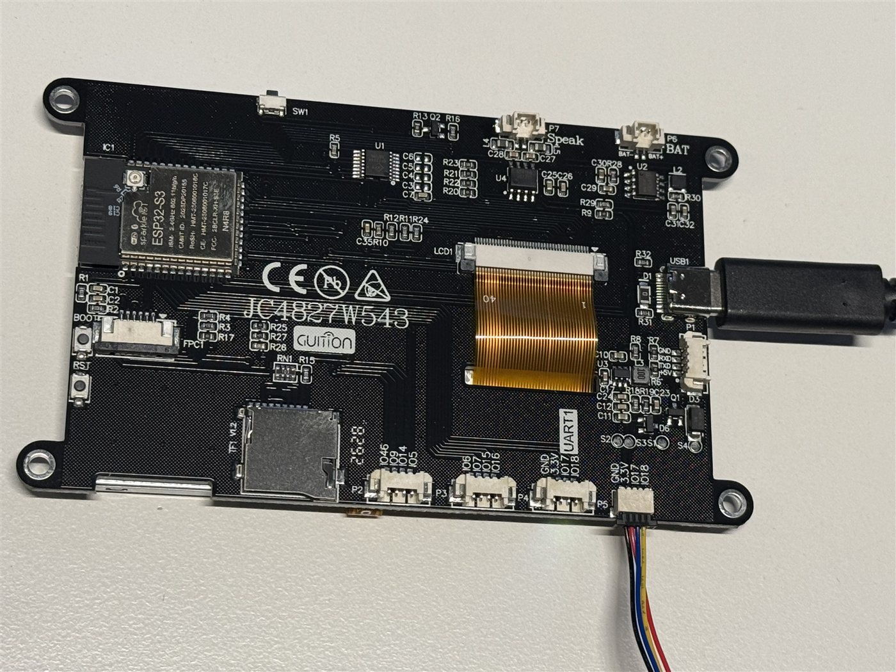

# Guition JC4827W543 — wo DAC, MIDI und Encoder angeschlossen werden

Für das SID-Synth-Gerät (Firmware `pio run -e guition`, Pins in
[`Firmware/src/synth/board.h`](../Firmware/src/synth/board.h)). Stand 19.11.2026.



## Die Stecker

Die Aufdrucke stehen auf der Platine neben jedem Stecker. Die Reihenfolge unten ist die
des Aufdrucks: bei P2–P5 von links nach rechts (Platine wie auf dem Foto, Stecker am
unteren Rand), bei P1 von oben nach unten (rechter Rand, neben der USB-C-Buchse).

| Stecker | Aufdruck (Pin 1 → 4) | Belegung im SID-Gerät |
|---|---|---|
| **P1** | GND · RXD · TXD · +5V | **DAC-Versorgung:** GND und +5V. RXD/TXD frei lassen |
| P2 | IO46 · IO9 · IO14 · IO5 | frei (Reserve; IO46 ist ein Boot-Pin, nicht benutzen) |
| **P3** | IO6 · IO7 · IO15 · IO16 | **DAC-Signale** (IO6, IO7, IO15) und **MIDI-Eingang** (IO16) |
| **P4** | GND · 3.3V · IO17 · IO18 | **MIDI-Modul-Versorgung:** GND und 3.3V. IO17/IO18 **nicht** belegen |
| **P5** | GND · 3.3V · IO17 · IO18 | **Encoder-Board**, STEMMA-QT-Kabel — steckt schon |

P4 und P5 führen dieselben Leitungen IO17/IO18 (den I2C-Bus des Encoder-Boards). An P4
daher nur GND und 3,3 V abgreifen.

Steckertyp: P5 ist eine STEMMA-QT-/Qwiic-Buchse (JST SH, 1,0 mm). P1–P4 sind kleine
4-polige Buchsen, vermutlich 1,25 mm Raster (Guition legt meist ein passendes Kabel
bei) — vor dem Bestellen von Kabeln mit dem beiliegenden Kabel oder einem Messschieber
prüfen. Gebraucht werden Kabel mit diesem Stecker auf Dupont-**Buchse**.

> **Vor dem ersten Einschalten mit dem Multimeter prüfen** (Board über USB-C versorgt):
> P1 Pin 1 → Pin 4 ≈ 5 V, P4 Pin 1 → Pin 2 ≈ 3,3 V. Erst dann Module anstecken.
> Die GPIOs des ESP32-S3 vertragen **nur 3,3 V** — nie 5 V an IO6/7/15/16.

## Audio: DAC-Modul GY-PCM5102 (pHAT-Bauform)

Das Modul hat die 40-polige Stiftleiste eines Raspberry-Pi-HATs; die Pin-Nummern unten
sind die der Pi-Belegung (wie schon bei der alten Box, siehe NOTES.md). Im Zweifel die
Beschriftung auf dem Modul oder dessen Datenblatt nehmen.

```
GY-PCM5102 (Pi-Pin)           Guition
  Pin  2  5V  ─────────────── P1 +5V   (Pin 4)
  Pin  6  GND ─────────────── P1 GND   (Pin 1)
  Pin 12  BCK ─────────────── P3 IO6   (Pin 1)
  Pin 35  LRCK ────────────── P3 IO7   (Pin 2)
  Pin 40  DIN ─────────────── P3 IO15  (Pin 3)
```

- **SCK** des PCM5102 auf GND (bei den pHAT-Modulen meist schon so verdrahtet; der Chip
  erzeugt den Takt dann selbst aus BCK).
- **Lötbrücken** auf der Rückseite: FLT = L, DEMP = L, **XSMT = H**, FMT = L.
  XSMT auf L schaltet stumm — die häufigste Ursache für „kommt nichts raus“.
- Ausgang: die 3,5-mm-Klinke des Moduls, **Line-Pegel** → Line-Eingang von Mischpult
  oder AG06 (nicht der Instrumenten-/Hi-Z-Eingang).
- 44,1 kHz, 16 Bit, I2S-Standardformat, das Gerät ist Takt-Master.

## MIDI-Eingang (DIN)

Ein fertiges MIDI-IN-Modul mit Optokoppler (z. B. 6N138, H11L1, PC900), das mit
**3,3 V** läuft. Der Optokoppler trennt das Instrument elektrisch vom Gerät; ohne ihn
darf keine DIN-Buchse an den ESP32.

```
MIDI-IN-Modul               Guition
  VCC ─────────────────────── P4 3.3V  (Pin 2)   ← nicht 5 V!
  GND ─────────────────────── P4 GND   (Pin 1)
  RX / OUT / TX* ──────────── P3 IO16  (Pin 4)
```

\* Je nach Modul heißt der Ausgang des Optokopplers „RX“, „OUT“, „TX“ oder „MIDI_RX“ —
gemeint ist die Leitung, auf der die MIDI-Daten zum Mikrocontroller gehen.

- Mit 5 V versorgt, zöge das Modul IO16 auf 5 V — das hält der ESP32-S3 nicht aus.
- Hat das Modul nur Lötpunkte für die DIN-Buchse: Buchsen-Pin 4 und 5 an den
  Optokoppler-Eingang (Pin 2 der Buchse bleibt beim Eingang frei).
- Kein MIDI OUT: die Firmware sendet nichts, ein OUT-Anschluss am Modul bleibt frei.
- In der Firmware ist auf IO16 ein Pull-up eingeschaltet; ohne gestecktes Modul liest
  der Eingang deshalb keine Störnoten.
- Gespielt wird die Casio DG-20: ihr MIDI-OUT mit einem normalen 5-poligen DIN-Kabel an
  die Buchse des Moduls.

## Encoder-Board (steckt schon)

```
Encoder-Board (STEMMA QT)   Guition P5
  schwarz  GND ─────────────── GND    (Pin 1)
  rot      3V3 ─────────────── 3.3V   (Pin 2)
  blau     SDA ─────────────── IO17   (Pin 3)
  gelb     SCL ─────────────── IO18   (Pin 4)
```

Adafruit I2C Quad Rotary Encoder 5752, Adresse 0x49. Im Startprotokoll steht
`ENC   Encoder-Board gefunden`.

## Intern belegt — nicht anschließen

| Funktion | GPIO |
|---|---|
| Display NV3041A (QSPI) | CS 45, SCK 47, D0 21, D1 48, D2 40, D3 39 |
| Hintergrundlicht | 1 |
| USB-C (Konsole, Flashen) | 19, 20 |
| PSRAM (Octal) | 35, 36, 37 |
| Konsole UART0 an P1 | 43 (TXD), 44 (RXD) — in dieser Firmware unbenutzt |

Touch, SD-Karte und der eingebaute Lautsprecher-Verstärker (Buchse „Speak“) werden nicht
benutzt.

## Nach dem Anschließen prüfen

An der Konsole (USB-C, am Firmen-PC COM15):

1. Startprotokoll: `MIDI  DIN an GPIO 16`, `ENC   Encoder-Board gefunden`.
2. **DAC:** `on 60 100` → Ton aus der Klinke des DAC-Moduls, `off 60`. `peak` zeigt den
   Pegel (erwartet ~12 000–15 000 beim Werksklang 1).
3. **MIDI:** `miditrace 1`, dann auf der DG-20 spielen → je Taste eine Zeile
   `MIDI  Kanal … On …`. Kommt nichts: Modul-Versorgung (3,3 V an P4) und die Leitung an
   IO16 prüfen; kommen Zeilen ohne Spielen: Modul-Ausgang offen oder falsch herum.
4. `stat` zeigt `"midi":<Anzahl>` — zählt jede empfangene MIDI-Nachricht.

Andere Pins wählen: in [`board.h`](../Firmware/src/synth/board.h) unter
`BOARD_GUITION_JC4827W543` (`kI2sBckPin`, `kI2sWsPin`, `kI2sDoutPin`, `kMidiRxPin`), dann
neu flashen. Frei wären noch IO5, IO9 und IO14 an P2.
